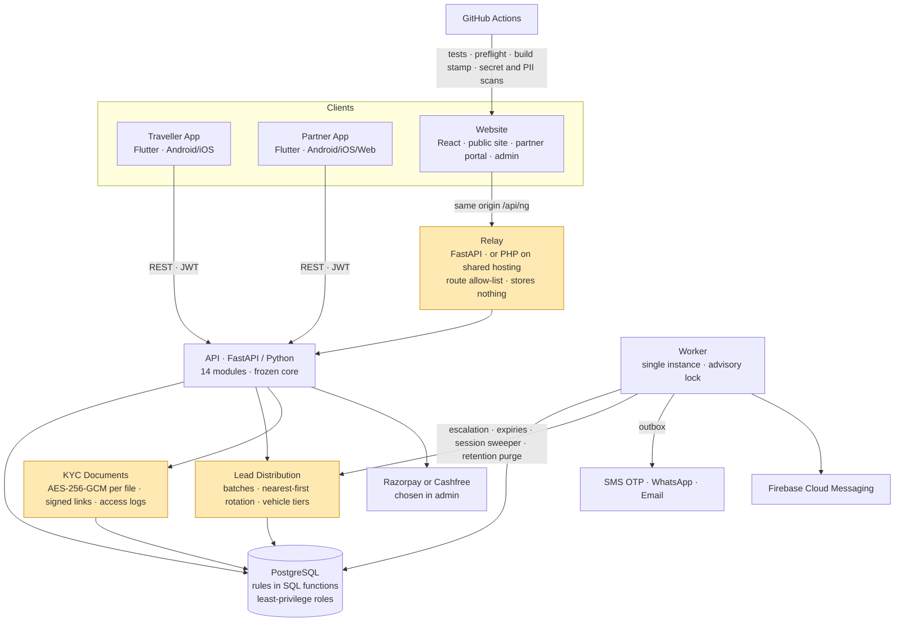

# Verified Cab Enquiry Network

A marketplace for outstation cab trips in India. A traveller posts a trip enquiry, verified cab partners (drivers, cab owners and fleet operators) receive it in fair rotation, and the two then deal directly. It runs on two Flutter apps (traveller and partner), one React website that holds the public site, a partner web portal and the super admin panel, and a FastAPI and PostgreSQL backend with a background worker. The engagement covered replacing a prototype backend with a production one, the lead distribution engine, partner verification and KYC document security, membership billing, push and WhatsApp messaging, and porting the mobile app from React Native to Flutter as two separate apps.

---

## Context

The client is a cab enquiry brand launching in South India. The business model is narrow on purpose: the platform does not book or price trips. It puts a traveller in touch with a small number of verified partners who can actually do the trip, and partners pay a membership to receive enquiries. The value to both sides is trust. Travellers need to know the partners are real and checked, and partners need to know enquiries are shared fairly and not sprayed to everyone.

The product started as a prototype generated and hosted on an AI app-builder platform, with an external backend and a React Native app. That was enough to demo, but not to launch. The backend lived outside the client's control, the mobile app had been written against an older version of the API and no longer matched it in more than 40 places, and the rules that matter most (who gets an enquiry, when a partner may see a traveller's phone number, how identity documents are stored) were not written down anywhere.

Two things made it harder than "rebuild the backend". First, the website, two apps and the admin panel all had to keep working while the backend underneath them changed. Second, the client was reviewing all of them in parallel and reporting fixes in rounds, so every round changed the API, the website and both apps at the same time.

## My Role

**Head of Engineering & Delivery (CTO), Vriksha Techno Solutions**

- Owned the architecture across seven parts: the backend API and worker, the website relay, the website (public site, partner portal, admin panel) and the two mobile apps.
- Designed the lead distribution engine: batches, escalation, nearest-first rotation per pool and vehicle tiers, with an admin view that explains why each partner was selected or skipped.
- Led the security model: keyed phone hashes, encrypted KYC documents, signed document links, least-privilege database roles and a data retention purge.
- Planned the move off the prototype platform, and the React Native to Flutter port with a written rule of zero functional and zero UI loss.
- Turned each client review round into a written API contract (one per round) that the backend, website and app work was built against, so three codebases changed together.
- Ran delivery with AI coding agents under a governance method, the same one described in [vrix-concierge-build-story](https://github.com/ksanusha84/vrix-concierge-build-story). The backend was split into modules with one owner each and a frozen shared core, agents worked in parallel on non-overlapping files, and nothing was reported fixed until a test or a live check had confirmed it.

## Architecture (high level)

## Tech Stack

- **Backend:** Python, FastAPI (async), psycopg 3, a module-per-domain layout (identity, enquiries, leads, duty, documents, billing, admin and others) on a frozen shared core
- **Database:** PostgreSQL, with business rules in SQL functions, six database roles (owner, app, read-only, retention, migrator, backup) and a migration runner that refuses drift
- **Worker:** scheduled jobs and a message loop in one process, kept to a single instance by a PostgreSQL advisory lock
- **Mobile:** Flutter for both apps (Provider, go_router), Firebase Cloud Messaging, Razorpay Checkout SDK, geolocation
- **Web:** React 19, Tailwind, shadcn/ui; one single-page app for the public site, the partner portal and the admin panel
- **Relay:** FastAPI, plus a PHP edition with the same route allow-list for shared cPanel hosting
- **Payments:** Razorpay or Cashfree, selected and configured from the admin panel, with gateway secrets encrypted at rest
- **Messaging:** SMS OTP and WhatsApp Business templates (2Factor), email (SMTP, SES or Resend), FCM push
- **Delivery:** GitHub Actions running the web tests, relay tests, a PHP relay simulation, phone-size UI tests (iPhone and Pixel profiles), Docker builds with header checks, and gitleaks. Docker Compose, systemd or cPanel for hosting.

## Key Technical Decisions

**Own the backend, and put a relay in front of it.**
The website never talks to the backend host directly. It calls its own origin, and a small relay forwards only the routes on an allow-list and returns 404 for everything else. The relay stores nothing. That let the prototype backend be replaced by the new one with a configuration change, keeps the backend host, SMS key and admin credentials off the browser, and lets the same site run on Docker, a Linux VM or shared hosting (a PHP relay that loads the same allow-list file).

**One gate decides when an enquiry goes out.**
An enquiry goes to at most 5 partners per batch. The next batch goes out only if nobody responded within 15 minutes, up to 3 batches, or if the traveller rejected all the partners they were shown. Before this rule was centralised, a partner turning duty on could trigger a send that skipped the window and the batch cap, which is how a sixth partner sometimes got an enquiry. Now one database function makes that decision for both the scheduled escalation tick and the duty-on trigger, so a partner coming online gets exactly what the next tick would have sent.

**Nearest first, but rotated, so no partner is starved.**
Eligibility is a strict list of gates: admin approval, active account, valid documents, live membership, duty on, the trip type, and coverage of the trip by location (40 km), declared route or city. Eligible partners are then ordered by distance from the pickup and grouped into pools by city and vehicle type. Each pool remembers the last partner it served and the next batch continues from there. With 7 partners, the first enquiry goes to partners 1 to 5 and the next one to 6, 7, 1, 2 and 3. Partners with the requested vehicle come first, and others with enough seats fill the batch, so an enquiry is never left unmatched because of the car model. The admin panel shows each enquiry's pool, batches and the reason every partner was selected or skipped.

**A traveller's phone number is a gate, not a field.**
Partners see a lead without the traveller's contact details. The number is unlocked only after the partner shows interest, and only while the enquiry is open, not confirmed with someone else, not revoked and the partner is still authorised. This check runs live in the database on every request, not once when the lead is created. Refused attempts are written to a contact access log. A partner claiming a lead is recorded separately from the traveller confirming a booking.

**Identity documents are encrypted per file and opened only by signed links.**
Licences, RCs, insurance, permits and photos are stored encrypted with AES-256-GCM, one key operation per file, and the file type is checked from its bytes, not its name. A document is viewed through a short-lived signed link bound to one document. Partner, admin and receipt links are signed with separate derived keys, so a partner's link can't open the admin view. Every view is logged.

**Phone numbers are identities, so normalise them before hashing.**
Phones are stored and rate-limited by a keyed hash of the normalised international number. Digits in other scripts (Devanagari, Arabic-Indic, full-width) are converted to ASCII first, and the country is taken from the number itself rather than the dropdown, so the same phone can't be typed two ways to get around the OTP limits. In staging and production the API refuses to start unless every secret is set, at least 32 characters long and all different.

**Every external provider sits behind a port.**
SMS, WhatsApp, email and payments are interfaces. In development they are in-memory fakes, so tests never contact an external host. In production, an unconfigured provider fails loudly instead of being quietly faked. Messages are queued in an outbox inside the same transaction as the event, with idempotency keys, and sent by the worker. WhatsApp template names live in the database, so when the client gets a new template approved, it starts sending without a code change.

**Port the mobile app exactly, then split it.**
The React Native app was ported to Flutter under a written rule: every screen matches its original in layout, spacing, colours, text (character for character), API calls, validation and empty and error states, with a file-by-file mapping guide. The partner and traveller sides were then split into two apps with separate store identities. An audit against the backend source found more than 40 places where the original app no longer matched the API, including enquiry dates in a format the backend rejected and a partner login that called the wrong endpoint. These are listed and fixed screen by screen, with contract tests against recorded fixtures.

**Releases check themselves, and tests refuse production.**
A production build runs a preflight check, writes a build stamp, and is followed by a read-only post-deploy verifier. Secret and personal-data scans run offline and in CI. The test batteries and the end-to-end flow test check the target before sending any request and exit if it is production. A retention job, using its own restricted database role, deletes or blanks old OTPs, location pings, sessions and message payloads on fixed schedules.

## Scale & Outcomes

- **7 parts** on one backend: 2 Flutter apps, the website (public site, partner portal and admin panel), the relay in two editions, the API and the worker
- About **190,000 lines** across Python, SQL, TypeScript/JavaScript and Dart, including about **45,000 lines of tests**
- **240+ API endpoints** across **14 backend modules**, about **100 database tables** and **40+ migrations**
- **1,480+ backend tests**, **360+ Flutter tests** across both apps, and 60+ web test files
- **70 app screens** across the two apps and **50+ web pages**
- The platform runs on a backend the client owns, with no code dependency on the prototype platform
- Fair, explainable lead distribution, with every selection and skip visible to admin
- Traveller contact details, partner identity documents and phone numbers protected by default, with access logged
- Every client review round delivered against a written contract across the API, website and both apps

*(Enquiry volumes, partner counts, revenue and client-identifying details are confidential.)*

## What I'd Do Differently

- **Own the backend from day one.** Starting from a prototype backend outside the client's control meant the apps were built against an API that later changed under them. Most of the 40+ app gaps were drift, not bugs.
- **Put contract tests between the apps and the API from the start.** Contract tests against recorded responses were added during the port. With them from the first build, the drift would have failed CI instead of turning up in an audit.
- **Write the distribution rules as one state machine before the first line of code.** Batching, escalation and the duty-on trigger began as separate paths, and the sixth-partner bug lived in the gap between them.
- **Set up push, store signing and payment gateways in the first week.** Push silently does nothing until the client's Firebase and APNs files exist, and payments wait on gateway keys. Those are owner tasks that take days, and should start before the code needs them.
- **Choose a maintained web toolchain.** The website inherited Create React App, which is no longer developed. Moving it to Vite is cheap early and expensive later.

## Note

This is a sanitized case study of production work delivered to a private client. Source code is not included due to confidentiality. The architecture, decisions and lessons reflect my direct engineering leadership on the project.
